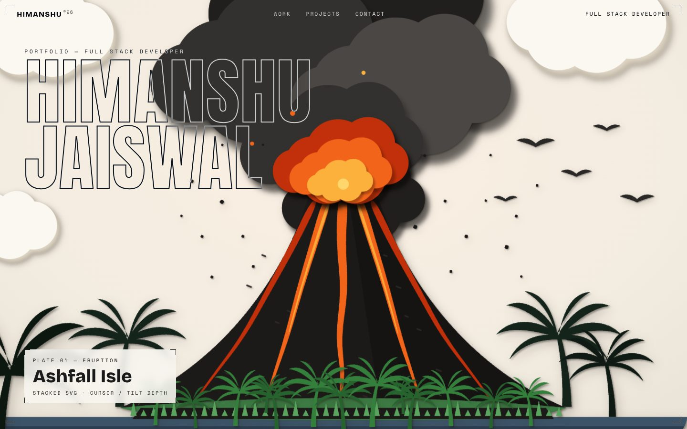
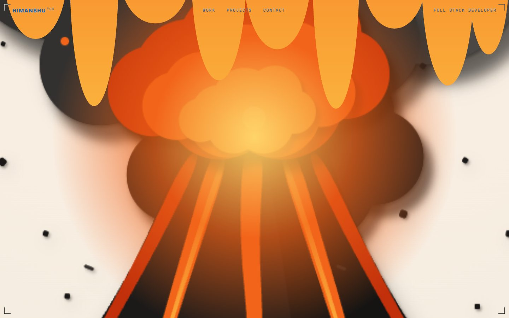
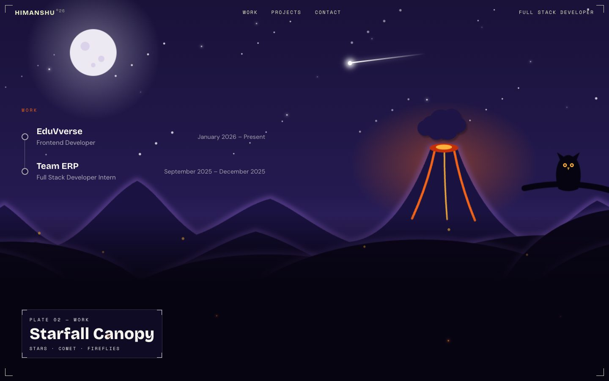
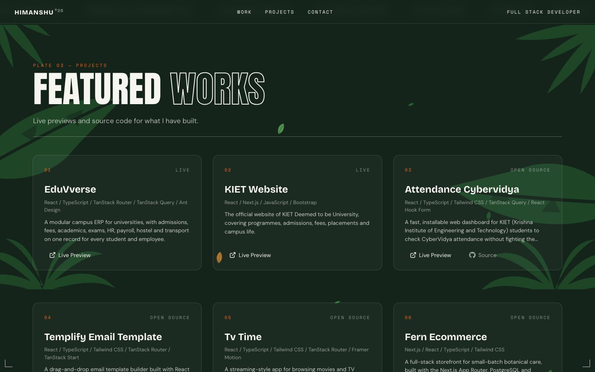
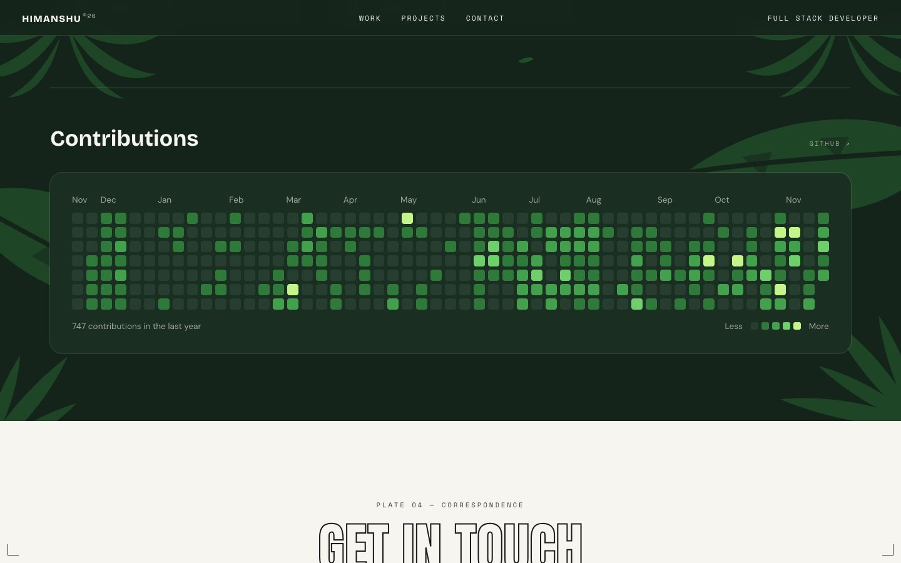
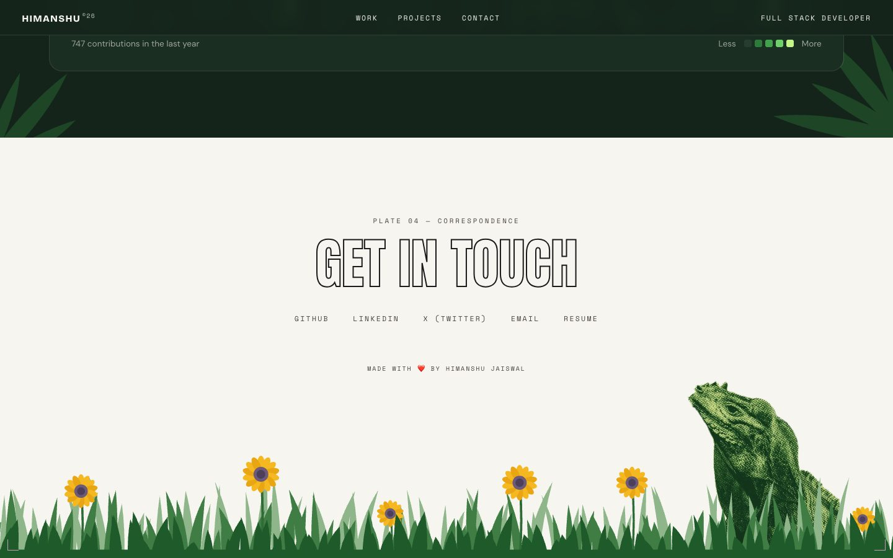

# Himanshu Jaiswal — Portfolio

A paper-cut, parallax portfolio. The page opens on an erupting volcano, dives
into a starlit grove that carries my work history, then moves on to projects, a
GitHub contribution calendar and a meadow footer. Every scene is hand-built SVG.



## Screenshots

| | |
| --- | --- |
|  |  |
| **Lava dive.** Scrolling zooms into the crater. | **Work.** The grove at night, with roles and dates. |
|  |  |
| **Projects.** Cards for live previews and source. | **Contributions.** GitHub calendar with instant tooltips. |



## Highlights

- **One pinned scroll journey.** A single scrubbed GSAP timeline drives the volcano, lava curtain and grove.
- **Layered paper-cut scenes.** SVG layers are rasterised once at runtime, then moved with transforms only.
- **Responsive and touch aware.** Fluid type and gutters, lighter effects on touch devices, native scrolling on phones.
- **Accessible motion.** `prefers-reduced-motion` switches off smooth scroll and parallax.
- **Static export.** No server required; deploys to Cloudflare Pages.

## Tech stack

| Area      | Choice                                                       |
| --------- | ------------------------------------------------------------ |
| Framework | Next.js 16 (App Router), React 19, TypeScript                |
| Styling   | Tailwind CSS v4, shadcn/ui primitives, theme tokens in `app/globals.css` |
| Motion    | GSAP + ScrollTrigger, Lenis smooth scroll                    |
| Tooling   | Bun (packages and scripts), Biome (lint and format)          |

## Getting started

Requires [Bun](https://bun.sh).

```bash
bun install
bun run dev
```

Open <http://localhost:3000>.

| Script                  | What it does                                           |
| ----------------------- | ------------------------------------------------------ |
| `bun run dev`           | Start the dev server                                   |
| `bun run build`         | Production build (static export to `out/`)             |
| `bun run start`         | Serve the production build                             |
| `bun run check`         | Lint, format and organise imports, applying safe fixes |
| `bun run lint`          | Lint only                                              |
| `bun run format`        | Format only                                            |
| `bun run sync:projects` | Refresh the project list from GitHub                   |
| `bun run sync:activity` | Refresh the contribution calendar from GitHub          |

## Project structure

```
app/                       Root layout, page and global CSS (theme tokens, keyframes)
components/
  ui/                      shadcn/ui primitives plus shared bits (Button, Card, OutlineText, icons)
  layout/                  Loader, SiteNav, SiteFooter, FooterGrass
  sections/                IslandJourney, ProjectsSection, ActivitySection, Marquee, LavaCurtain, LeafBreeze
  parallax/                PaperParallax, BakedScene, NightSky
  providers/               SmoothScroll (Lenis, wired to GSAP)
hooks/                     useParallax, useRevealOnScroll
lib/
  utils.ts                 cn() class merger
  media.ts                 prefersReducedMotion(), isCoarsePointer()
  styles.ts                Shared class strings and helpers
  parallax/                rasterize and bake-status logic (no JSX)
scenes/
  primitives/              Reusable SVG shapes (palms, leaves, owl)
  *Scene.tsx               Layer stacks for each scene
content/
  site.ts                  Name, role, page title, footer links
  skills.ts                Skills strip
  experience.ts            Work history shown on the grove slide
  projects.ts              Hand-written projects plus the generated list
  generated/               Written by the sync scripts — do not edit by hand
scripts/                   sync-projects.ts, sync-activity.ts
public/                    Resume PDF, `_headers`, images
docs/                      Design spec
```

Rule of thumb: components render, `lib/` and `hooks/` hold reusable logic,
`content/` holds text, `scenes/` holds artwork.

## Editing content

| To change…                         | Edit                    |
| ---------------------------------- | ----------------------- |
| Name, role, links                  | `content/site.ts`       |
| Skills strip                       | `content/skills.ts`     |
| Work history                       | `content/experience.ts` |
| Projects that are not on GitHub    | `content/projects.ts`   |
| Colours, gutters, display text size | `app/globals.css`       |

## Syncing from GitHub

```bash
bun run sync:projects   # writes content/generated/repos.json
bun run sync:activity   # writes content/generated/activity.json
```

`sync:projects` reads the repos listed in `FEATURED` inside
`scripts/sync-projects.ts`. Each card's tech line comes from the repo's
`package.json`, and its description from the README. To add a project, add its
repo name to `FEATURED`, run the script, and save a preview image as
`public/images/projects/<repo-name>.webp` (lowercase).

GitHub limits anonymous API calls. If you hit the limit, copy `.env.example` to
`.env` and set `GITHUB_TOKEN`. `.env` is git-ignored and must never be committed.

## Adding UI components

shadcn/ui is configured in `components.json`. Add a primitive with:

```bash
bunx shadcn@latest add <component>
```

Check the generated file imports `cn` from `@/lib/utils`, then run
`bun run check`. Prefer Tailwind utilities and the tokens in `app/globals.css`;
write plain CSS there only when Tailwind cannot express it (for example
keyframes).

## How the scroll works

The hero is one pinned, sticky stage. A scrubbed GSAP timeline lifts the volcano
away, pours a lava curtain over the screen and reveals the grove and work
history, while Lenis smooths wheel input on desktop. Touch devices keep native
scrolling and get a softer scrub, a shorter scroll run and lighter blur effects.

## Deploying to Cloudflare Pages

The site is a static export (`output: "export"` in `next.config.mjs`).

| Setting                | Value           |
| ---------------------- | --------------- |
| Framework preset       | None            |
| Build command          | `bun run build` |
| Build output directory | `out`           |
| Root directory         | leave blank     |

No environment variables are required. To preview the exact output locally, run
`bun run build` and serve `out/` with any static server.

## Assets

The footer lizard is Greptile's mascot artwork. Make sure you have the right to
use it before publishing.
